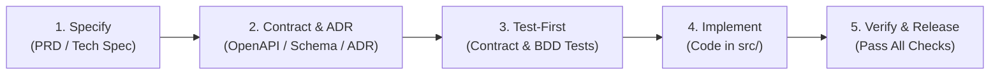

# Spec-Driven Development (SDD) Workflow & Guidelines

This project adheres strictly to **Spec-First / Spec-Driven Development (SDD)**. No implementation code is written without an approved specification and corresponding contract/acceptance definitions.

---

## The Spec-First Lifecycle

### Phase 1: Specify (Requirements & Architecture)
1. **Define Requirements**: Copy `specs/templates/prd-template.md` to `specs/01-requirements/<feature-name>.md`. Clarify goals, non-goals, and acceptance criteria.
2. **Draft Technical Specification**: Copy `specs/templates/tech-spec-template.md` to `specs/02-architecture/<feature-name>-tech-spec.md`.
3. **Capture Architectural Choices**: For any non-trivial design or tech choice, create an ADR in `specs/02-architecture/adrs/` using `specs/templates/adr-template.md`.

### Phase 2: Contract Definition
1. **Formalize the Interface**:
   - For HTTP/REST: Update or extend `specs/03-api/openapi.yaml`.
   - For data models / event payloads: Store JSON Schemas in `specs/03-api/schemas/`.
2. **Specify Acceptance Scenarios**:
   - Write Gherkin/BDD scenarios in `specs/04-acceptance/features/<feature-name>.feature`.

### Phase 3: Test-First (Red Phase)
1. **Contract Testing**:
   - Add contract tests in `tests/contract/` using your framework (e.g., Prism, Dredd, Pact, Schemathesis, or Jest/Pytest with schema validators).
   - Tests validate that responses strictly adhere to `specs/03-api/openapi.yaml`.
2. **Unit / Acceptance Stubs**:
   - Write failing test stubs in `tests/unit/` and `tests/integration/`.
   - Ensure tests fail as expected (verifying that they test the new behavior).

### Phase 4: Implementation (Green Phase)
1. **Task Breakdown**:
   - Fill out `specs/templates/task-breakdown-template.md` in `specs/05-tasks/<feature-name>-tasks.md`.
2. **Implement Code in `src/`**:
   - Follow domain-driven, layered, or clean architecture.
   - Code until all contract, unit, and integration tests pass.

### Phase 5: Verification & Governance
1. Verify 100% contract compliance against the specification.
2. Run test suites and static analysis.
3. Open a Pull Request referencing the approved spec document.

---

## Golden Rules of Spec-First

1. **Specification is the Single Source of Truth**: Code conforms to the specification, never the reverse without an explicit spec revision.
2. **Never Commit Code Without a Linked Spec**: Every feature branch or PR must cite its spec in `specs/`.
3. **Drift Prevention**: If implementation reveals unexpected edge cases, update and re-review the spec first before altering production logic.
4. **Automated Contracts**: Changes to `specs/03-api/` should break contract test suites if the API implementation diverges.
