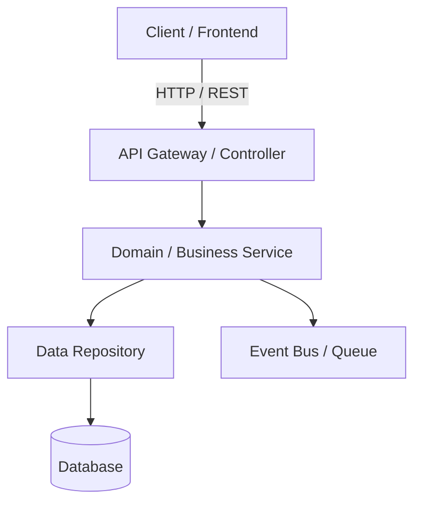
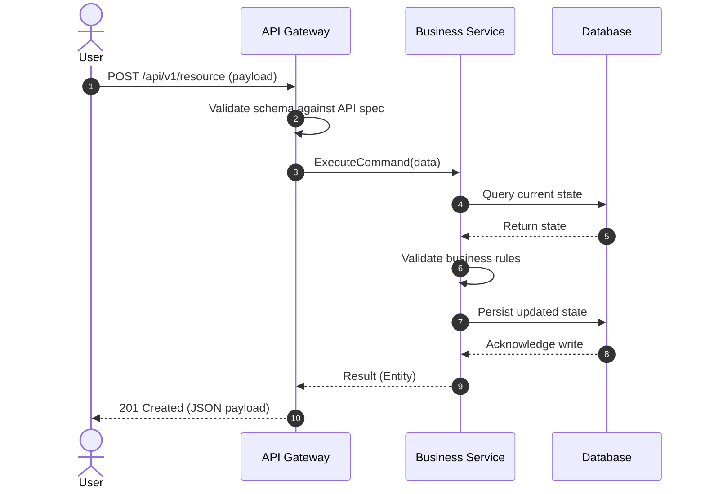

# [Tech Spec] Feature / Component Name

| Attribute | Details |
| :--- | :--- |
| **Status** | Draft \| In Review \| Approved \| In Implementation \| Completed |
| **Author(s)** | [Lead Engineer / Architect] |
| **Date** | YYYY-MM-DD |
| **PRD Link** | [Link to PRD](../01-requirements/...) |
| **ADR Links** | [Link to ADRs](../02-architecture/adrs/...) |
| **API Contract** | [Link to API Spec](../03-api/...) |

---

## 1. Overview & Context
- Brief summary of the engineering context and technical objectives.
- Reference to the requirements being addressed.

---

## 2. System Architecture & Components
Describe high-level components and their responsibilities.

### Component Breakdown
1. **Controller / Interface Layer**: Handles protocol parsing, validation, and serialization.
2. **Domain / Business Logic Layer**: Enforces business invariants and core logic.
3. **Infrastructure / Persistence Layer**: Interacts with databases, external APIs, queues.

---

## 3. Data Models & Schema Design

### Entity: `ExampleEntity`
| Field | Type | Required | Description |
| :--- | :--- | :--- | :--- |
| `id` | UUID / String | Yes | Unique identifier |
| `name` | String | Yes | Descriptive label |
| `status` | Enum (`DRAFT`, `ACTIVE`) | Yes | Lifecycle status |
| `created_at` | Timestamp | Yes | Creation timestamp |

---

## 4. API & Interface Contracts
- **Protocols**: REST / gRPC / GraphQL / WebSocket / Event-driven
- **Specification Source**: Points to file in `specs/03-api/`

---

## 5. Sequence Flows

---

## 6. Failure Modes, Error Handling & Observability
- **Error Schema**: Standard RFC 7807 (Problem Details).
- **Retry & Circuit Breaking**: Policy for downstream dependencies.
- **Metrics & Logging**: Key metrics (request rate, latency, error rate) and log context (correlation IDs).

---

## 7. Security, Privacy & Compliance
- **Authentication**: JWT / OAuth2 / API Key
- **Authorization**: RBAC / ABAC policies
- **Data Protection**: PII masking, encryption at rest/in transit

---

## 8. Migration, Rollout & Rollback Strategy
- **Deployment Strategy**: Blue-Green / Canary / Feature Flag
- **Feature Flag Name**: `feat_example_toggle`
- **Rollback Criteria**: Alert threshold (e.g., error rate > 1% for 5 mins)
